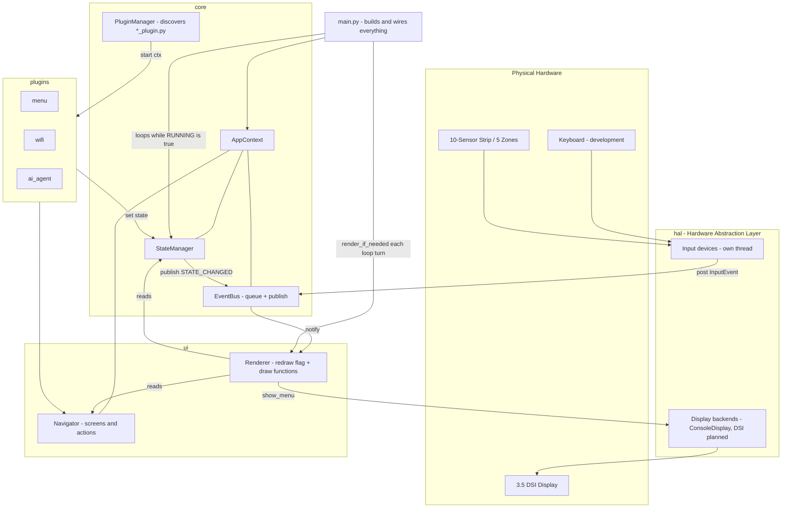
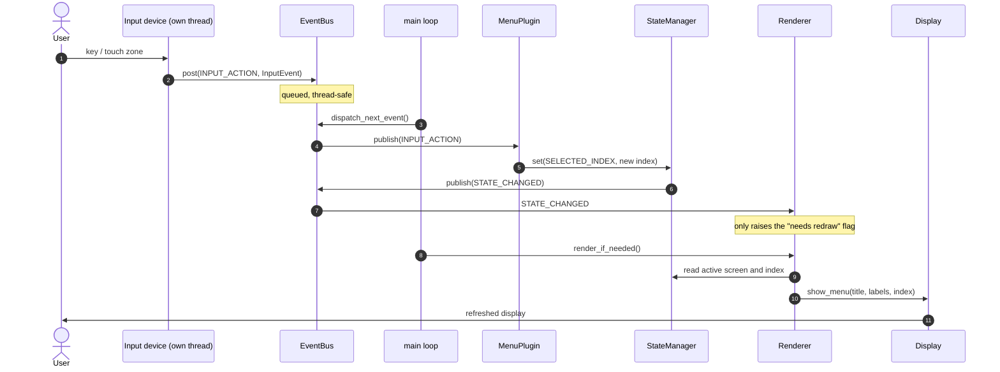

# System Architecture - Standalone Raspberry Pi Project

> Status: core, plugin system, navigator, renderer, console display, the
> scripted (dummy) input device and the explicit quit mechanism are
> implemented and tested.
> Planned: keyboard input device, DSI display backend, touch strip input,
> BACK / navigation history.

## 1. Component Diagram

## 2. Input Sequence

The UI is a function of the state: plugins only change the state, the
renderer decides what to draw. Several changes in one loop turn produce a
single redraw.

## 3. Rules

- **Threads**: only input devices run in their own thread. They use
  `EventBus.post()` and nothing else. All subscribers run in the main
  thread, one event at a time.
- **post vs publish**: `post` queues an event (any thread). `publish`
  delivers immediately and is called by the main thread only
  (inside `dispatch_next_event`, or by `StateManager`).
- **State is the single source of truth**: the active screen and the
  selected index live in `StateManager`. Screens are plain data and hold
  no selection. The state is changed from the main thread only.
- **Navigation**: screens are changed only through `Navigator.navigate_to()`
  (it ignores the screen that is already active). It resets the selected
  index *before* changing the active screen: `StateManager.set` notifies
  subscribers synchronously, so with the opposite order a subscriber could
  see the new screen together with the old index.
- **Rendering**: the `Renderer` never draws from an event handler. It only
  raises a flag; the main loop calls `render_if_needed()` once per turn.
  The display is used from the main thread only. The draw function is
  chosen with `isinstance`, so subclasses of a registered screen type are
  drawn too.
- **Displays are passive**: a `DisplayInterface` implementation draws what
  it is told. `show_menu` replaces whatever was on screen, so the caller
  never has to clear first. It knows nothing about screens or plugins.
- **Quit**: `StateKeys.RUNNING` in `StateManager` is the exit signal. It
  starts as `True`; the main loop runs while it is true, and an action
  (for example the Exit menu entry) quits by setting it to `False`.
  Quitting never touches the active screen.
- **Dependencies point one way**: `plugins` -> `ui`, `core`;
  `ui` and `hal` -> `core`; `core` imports nothing from the others
  at runtime (type-only imports go under `TYPE_CHECKING`).
  `hal` never imports `ui`.
  The only exception is `PluginManager`, which imports the `plugins`
  package at runtime because it needs it to discover the plugins.
- **Plugins** live in `plugins/<name>/<name>_plugin.py`, extend `Plugin`
  and talk to the rest only through `ctx` (events and state), never by
  importing each other.
- **Wiring**: `main.py` is the only place that creates the services and
  passes them down. The renderer must be started (subscribed) before the
  plugins, because `StateManager.set` publishes synchronously.
- **Logging**: with the console display, logs go to a file (`app.log`,
  ignored by git), otherwise they would be mixed with the menu on the
  terminal.

## 4. Deferred items

Known limitations, postponed until they are really needed (most of them
when the second plugin and the keyboard device arrive):

- `EventBus` has no `unsubscribe`, so a plugin cannot clean up its
  subscriptions in `stop()`.
- `StateManager.set` accepts unknown keys without any warning.
- `DummyInput` cannot be restarted after `stop()`, because the stop
  signal stays set.
- The interfaces live in two places: `Plugin` in `core/interfaces`,
  `InputInterface` and `DisplayInterface` in `hal`.
- `Navigator.get_active_screen` is typed as `MenuScreen | None`; it will
  need a more general screen type when other kinds of screen exist.
