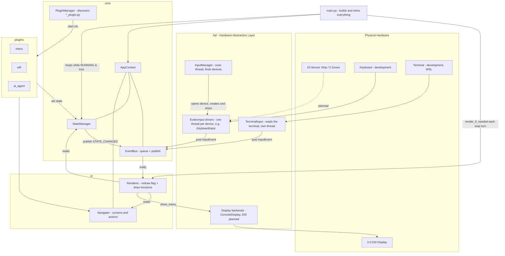
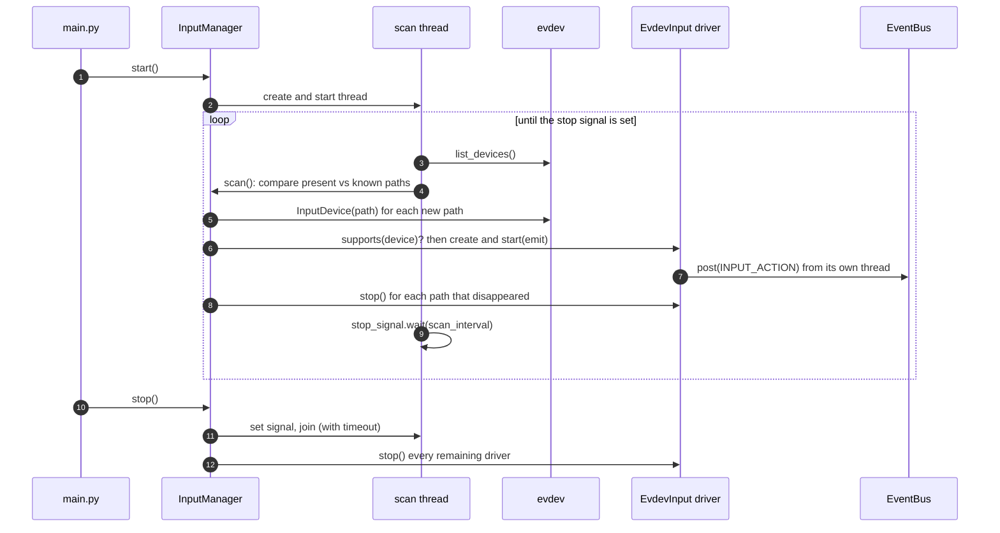
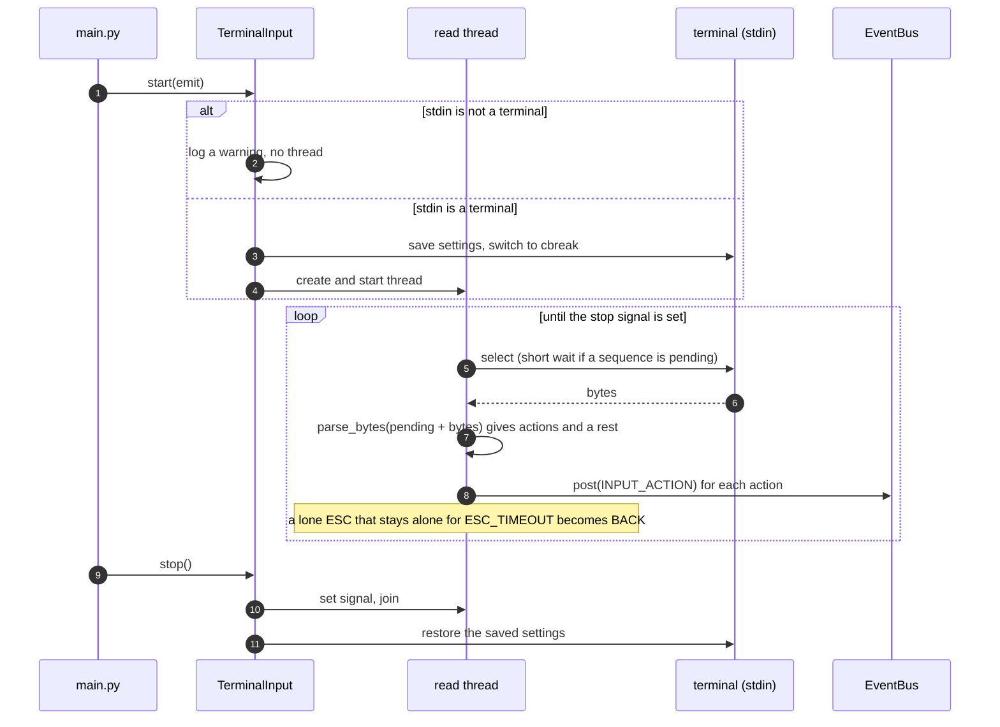

# System Architecture - Standalone Raspberry Pi Project

> Status: core, plugin system, navigator, renderer, console display, the
> explicit quit mechanism, the evdev input base class, the keyboard driver,
> the input manager (device discovery with a scan thread) and the terminal
> input (keys read from the terminal, for development) are implemented and
> tested. `main.py` starts the input manager and the terminal input.
> Planned: DSI display backend, touch strip input, BACK / navigation history.

## 1. Component Diagram

## 2. Input Sequence

The UI is a function of the state: plugins only change the state, the
renderer decides what to draw. Several changes in one loop turn produce a
single redraw.

## 3. Device Discovery Sequence

`InputManager` knows nothing about keyboards or joysticks: it only asks each
driver class whether it supports a device. The scan thread repeats `scan()`
at a fixed interval, so devices plugged in or removed while the app runs are
picked up.

## 4. Terminal Input Sequence

`TerminalInput` is the input used during development, where there is no
`/dev/input` (WSL) or the keyboard is the one of the terminal (SSH). It
changes the mode of the terminal while it runs and always puts it back.

## 5. Rules

- **Threads**: only the hardware layer runs in its own threads: one per
  input driver (evdev drivers and `TerminalInput`), plus the scan thread of
  `InputManager`. They never touch the state, the navigator or the
  renderer: the only thing they do toward the rest of the app is
  `EventBus.post()` (through `emit`). All subscribers run in the main
  thread, one event at a time.
- **Stopping threads**: a thread waits with `Event.wait(interval)` or a
  `select` with timeout, never with `sleep`, so `stop()` wakes it quickly.
  The order is always: set the signal, `join` the thread, and only then stop
  or restore what the thread was using (in `InputManager`, the drivers; in
  `TerminalInput`, the terminal). If a `join` times out, a warning is logged.
- **post vs publish**: `post` queues an event (any thread). `publish`
  delivers immediately and is called by the main thread only
  (inside `dispatch_next_event`, or by `StateManager`).
- **State is the single source of truth**: the active screen and the
  selected index live in `StateManager`. Screens are plain data and hold
  no selection. The state is changed from the main thread only.
- **Screens**: every screen extends `Screen` (only a `key`). Kinds of screen
  add their own fields (`MenuScreen` adds `title` and `options`). `Navigator`
  works with `Screen` and does not know the concrete kinds; whoever needs a
  specific kind (renderer, plugins) checks it with `isinstance`.
- **Navigation**: screens are changed only through `Navigator.navigate_to()`
  (it ignores the screen that is already active). It resets the selected
  index *before* changing the active screen: `StateManager.set` notifies
  subscribers synchronously, so with the opposite order a subscriber could
  see the new screen together with the old index.
- **Rendering**: the `Renderer` never draws from an event handler. It only
  raises a flag; the main loop calls `render_if_needed()` once per turn.
  The display is used from the main thread only. The draw function is
  chosen with `isinstance`, so subclasses of a registered screen type are
  drawn too.
- **Displays are passive**: a `DisplayInterface` implementation draws what
  it is told. `show_menu` replaces whatever was on screen, so the caller
  never has to clear first. It knows nothing about screens or plugins.
- **Input drivers**: every input implements `InputInterface` and emits only
  `InputActions`, never codes of its own.
  `EvdevInput` holds what every evdev device has in common (thread,
  `select` with timeout, stop). A concrete driver (for example
  `KeyboardInput`) only says which devices it `supports()` and how to
  `translate_event_to_action()` a raw event into an `InputActions` value.
  `TerminalInput` does not use evdev and does not extend `EvdevInput`.
- **Terminal input**: `TerminalInput` switches the terminal to `cbreak`
  (no line buffering, no echo, Ctrl+C still works) and restores the saved
  settings in `stop()`. If the standard input is not a terminal it does
  nothing and logs a warning. `parse_bytes` is a pure function: it returns
  the actions found and the trailing bytes of an incomplete escape sequence,
  which the read loop keeps for the next read. Keys that are not mapped
  (Home, Delete, F-keys, Alt+key) are ignored. A lone ESC is the Esc key
  (`BACK`) only if nothing follows within `ESC_TIMEOUT`.
- **Device failures**: a device that cannot be opened, or a driver whose
  `start()` fails, is logged and ignored; the scan never stops because of it.
  A driver owns its device: after the driver is created, only the driver
  closes it (in `stop()`).
- **Quit**: `StateKeys.RUNNING` in `StateManager` is the exit signal. It
  starts as `True`; the main loop runs while it is true, and an action
  (for example the Exit menu entry) quits by setting it to `False`.
  Quitting never touches the active screen.
- **Dependencies point one way**: `plugins` -> `ui`, `core`;
  `ui` and `hal` -> `core`; `core` imports nothing from the others
  at runtime (type-only imports go under `TYPE_CHECKING`).
  `hal` never imports `ui`.
  The only exception is `PluginManager`, which imports the `plugins`
  package at runtime because it needs it to discover the plugins.
- **Plugins** live in `plugins/<name>/<name>_plugin.py`, extend `Plugin`
  and talk to the rest only through `ctx` (events and state), never by
  importing each other.
- **Wiring**: `main.py` is the only place that creates the services and
  passes them down. The renderer must be started (subscribed) before the
  plugins, because `StateManager.set` publishes synchronously. At shutdown
  the inputs (the producers of events) are stopped first, then the display,
  then the plugins.
- **Logging**: with the console display, logs go to a file (`app.log`,
  ignored by git), otherwise they would be mixed with the menu on the
  terminal.

## 6. Deferred items

Known limitations, postponed until they are really needed:

- `EventBus` has no `unsubscribe`, so a plugin cannot clean up its
  subscriptions in `stop()`.
- `StateManager.set` accepts unknown keys without any warning.
- `InputManager` cannot be restarted after `stop()`, because the stop signal
  stays set. A new instance is created instead. If a restart is ever needed,
  each `start()` should create its own `Event`. `TerminalInput` can be
  restarted, because it clears the signal in `start()`: it must put the
  terminal back in a usable state.
- The interfaces live in two places: `Plugin` in `core/interfaces`,
  `InputInterface` and `DisplayInterface` in `hal`.
- `InputManager.stop()` waits at most `JOIN_TIMEOUT` for the scan thread. If
  a scan is stuck longer, the thread is left running and a warning is logged.
- A device that could not be opened (for example `PermissionError`, user not
  in the `input` group) is not retried until it is unplugged and plugged
  again.
- Some keyboards expose more than one file in `/dev/input`. If two of them
  support the arrow keys, events arrive twice. To be checked on the
  Raspberry.
- WSL has no `/dev/input`: `InputManager` finds nothing there, and the keys
  come from `TerminalInput`. The keyboard driver can only be tried on the
  Raspberry.
- On the Raspberry, if the app runs on the local console with a keyboard
  attached, `TerminalInput` and `KeyboardInput` both see the same key and
  events arrive twice. Both are always started for now; an option on the
  command line (for example to turn the terminal input off) is the likely
  fix if it becomes a problem.
- `TerminalInput` and `EvdevInput` repeat the same thread, `select` and stop
  scheme. A common base is not worth it with two cases.
- `TerminalInput` waits `ESC_TIMEOUT` before taking a lone ESC as the Esc
  key. With a slow connection (SSH) an arrow key can arrive split with a
  longer gap, and a stray `BACK` is then possible.
- `TerminalInput` uses `termios`, so it runs on Linux and macOS only.
  Its behavior when the terminal disappears (for example a closed SSH
  session) is not covered by tests.
- Device discovery is done by polling. Reacting to hot-plug events (udev)
  would remove the delay, but it adds a dependency and cannot be tried on
  WSL.
