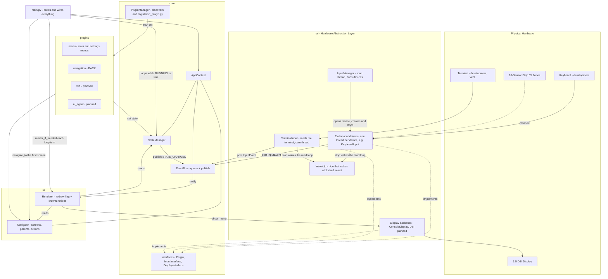
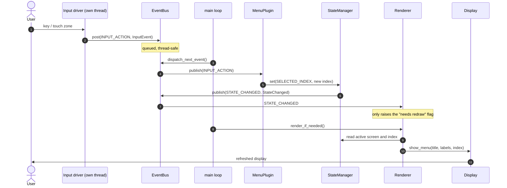
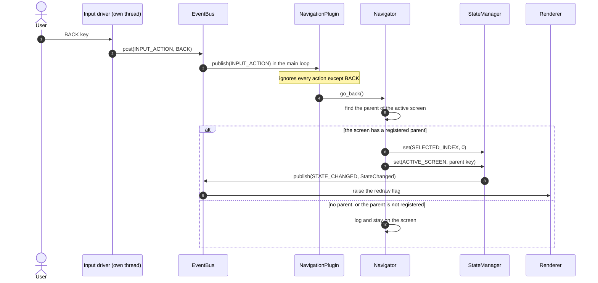
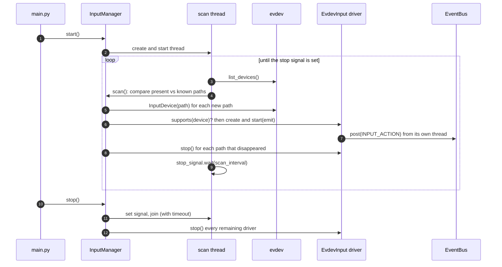
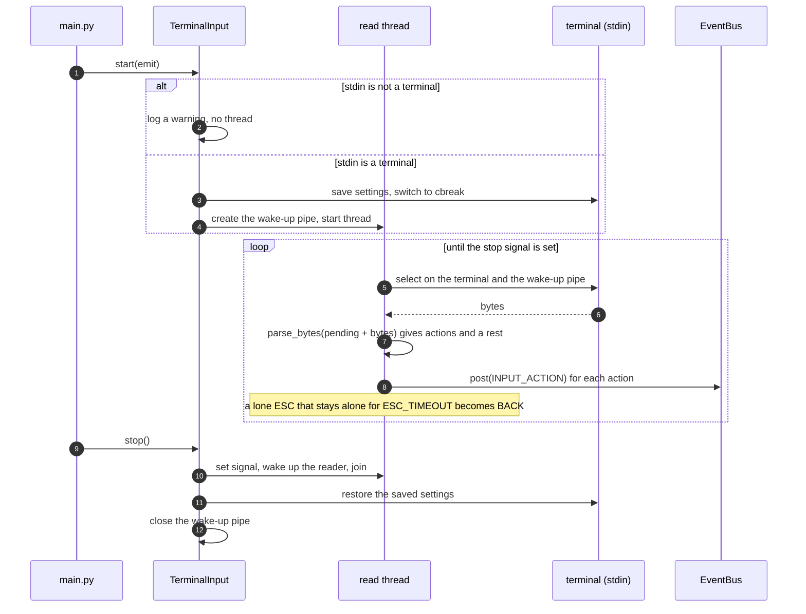

# System Architecture - Standalone Raspberry Pi Project

> Status: core, plugin system, navigator (with parent screens and `go_back`),
> renderer, console display, the evdev input base class, the keyboard driver,
> the input manager (device discovery with a scan thread) and the terminal
> input (keys read from the terminal, for development) are implemented and
> tested. The menu plugin provides the main menu and the settings menu; the
> navigation plugin turns the BACK key into `go_back`. The entries of both
> menus only log for now: the screens behind them are not written yet.
> Planned: translations (`StateKeys.LANGUAGE` already exists in the state;
> the translator and the language menu entry are not written), DSI display
> backend, touch strip input.

## 1. Component Diagram

## 2. Input Sequence

The UI is a function of the state: plugins only change the state, the
renderer decides what to draw. Several changes in one loop turn produce a
single redraw.

## 3. Back Navigation Sequence

Every plugin that listens to `INPUT_ACTION` reacts only to its own actions:
the menu plugin handles UP, DOWN and SELECT, the navigation plugin handles
BACK. `Navigator.go_back()` is the only code that knows what "back" means.

## 4. Device Discovery Sequence

`InputManager` knows nothing about keyboards or joysticks: it only asks each
driver class whether it supports a device. The scan thread repeats `scan()`
at a fixed interval, so devices plugged in or removed while the app runs are
picked up.

## 5. Terminal Input Sequence

`TerminalInput` is the input used during development, where there is no
`/dev/input` (WSL) or the keyboard is the one of the terminal (SSH). It
changes the mode of the terminal while it runs and always puts it back.

## 6. Rules

- **Threads**: only the hardware layer runs in its own threads: one per
  input driver (evdev drivers and `TerminalInput`), plus the scan thread of
  `InputManager`. They never touch the state, the navigator or the
  renderer: the only thing they do toward the rest of the app is
  `EventBus.post()` (through `emit`). All subscribers run in the main
  thread, one event at a time.
- **Stopping threads**: nobody polls with `sleep`. The scan thread waits with
  `Event.wait(interval)`. An input driver blocks in `select` on its file
  (the device or the terminal) *and* on a `WakeUp` pipe, with no timeout
  (only `TerminalInput` uses one, `ESC_TIMEOUT`, while a lone ESC may be the
  start of a sequence). `stop()` sets the stop signal, wakes the thread
  through the `WakeUp`, and `join`s it. Only then it stops or restores what
  the thread was using (in `InputManager`, the drivers; in `TerminalInput`,
  the terminal) and closes the `WakeUp`. If a `join` times out, a warning is
  logged and the `WakeUp` stays open, because the thread may still use it: a
  later `stop()` closes it.
- **WakeUp**: `hal/input/wakeup.py` wraps a non-blocking pipe. The waiting
  thread puts `fileno()` in its `select`; another thread calls `set()` to
  wake it. `set()` and `close()` are called from the same thread, and
  `close()` only after the waiting thread has ended. A driver creates a new
  `WakeUp` in every `start()`.
- **post vs publish**: `post` queues an event (any thread). `publish`
  delivers immediately and is called by the main thread only
  (inside `dispatch_next_event`, or by `StateManager`).
- **State is the single source of truth**: the active screen, the
  selected index and the language live in `StateManager`. Screens are plain
  data and hold no selection. The state is changed from the main thread
  only.
- **Event payloads** are frozen dataclasses: `InputEvent` for `INPUT_ACTION`
  and `StateChanged` (`key`, `value`) for `STATE_CHANGED`. A handler reads
  attributes, never string keys, so a typo is an error and not a silent
  `None`.
- **Screens**: every screen extends `Screen` (only a `key`). Kinds of screen
  add their own fields (`MenuScreen` adds `title` and `options`). Screens
  are immutable: the dataclasses are frozen and `options` is a tuple, so a
  screen cannot change after it is created. `Navigator` works with `Screen`
  and does not know the concrete kinds; whoever needs a specific kind
  (renderer, plugins) checks it with `isinstance`. Screen keys are lowercase
  strings (`"main"`, `"settings"`).
- **Navigation**: screens are changed only through `Navigator.navigate_to()`
  (it ignores the screen that is already active, and an unregistered one with
  a warning). It resets the selected index *before* changing the active
  screen: `StateManager.set` notifies subscribers synchronously, so with the
  opposite order a subscriber could see the new screen together with the old
  index.
- **Navigation tree**: screens form a tree. A screen is registered with an
  optional `parent` (the *key* of another screen, keyword-only); the
  navigator stores only the key, so it needs no access to the parent
  object. `Navigator.go_back()` goes to the parent of the active screen; a
  screen without a parent (the main menu) stays where it is. The parent is
  not read at the time of registration, so a child may be registered before
  its parent; if the parent is never registered, `go_back` logs a warning
  and stays. A screen has one parent only: where the same screen can be
  reached from two places, a history stack would be needed (see deferred).
  `go_back` is the only code that knows what "back" means; whoever reacts
  to the BACK key just calls it. A menu entry such as "Back to Main Menu"
  calls `go_back` too, it does not name the parent.
- **Rendering**: the `Renderer` never draws from an event handler. It only
  raises a flag; the main loop calls `render_if_needed()` once per turn.
  The display is used from the main thread only. The draw function is
  chosen with `isinstance`, so subclasses of a registered screen type are
  drawn too.
- **Displays are passive**: a `DisplayInterface` implementation draws what
  it is told. `show_menu` replaces whatever was on screen, so the caller
  never has to clear first. It knows nothing about screens or plugins.
- **Input drivers**: every input implements `InputInterface` and emits only
  `InputActions`, never codes of its own.
  `EvdevInput` holds what every evdev device has in common (thread,
  `select`, wake-up, stop). A concrete driver (for example `KeyboardInput`)
  only says which devices it `supports()` and how to
  `translate_event_to_action()` a raw event into an `InputActions` value.
  `TerminalInput` does not use evdev and does not extend `EvdevInput`. A
  second `start()` on a running driver is ignored.
- **Terminal input**: `TerminalInput` switches the terminal to `cbreak`
  (no line buffering, no echo, Ctrl+C still works) and restores the saved
  settings in `stop()`. If the standard input is not a terminal it does
  nothing and logs a warning. `parse_bytes` is a pure function: it returns
  the actions found and the trailing bytes of an incomplete escape sequence,
  which the read loop keeps for the next read. Keys that are not mapped
  (Home, Delete, F-keys, Alt+key) are ignored. A lone ESC is the Esc key
  (`BACK`) only if nothing follows within `ESC_TIMEOUT`. A read error is
  logged only if the driver is not stopping.
- **Device failures**: a device that cannot be opened, or a driver whose
  `start()` fails, is logged and ignored; the scan never stops because of it.
  A driver owns its device: after the driver is created, only the driver
  closes it (in `stop()`).
- **Quit**: `StateKeys.RUNNING` in `StateManager` is the exit signal. It
  starts as `True`; the main loop runs while it is true, and an action
  (for example the Exit menu entry) quits by setting it to `False`.
  Quitting never touches the active screen.
- **Interfaces**: all the contracts live in `core/interfaces`
  (`Plugin`, `InputInterface`, `DisplayInterface`). `hal` and `plugins`
  implement them; `ui` and `main.py` use them. This way `ui` never has to
  import `hal`.
- **Layout**: `hal/input` (`EvdevInput`, `KeyboardInput`, `TerminalInput`,
  `InputManager`, `WakeUp`) and `hal/display` (`ConsoleDisplay`). The
  plugins are `plugins/menu` (`main_menu.py`, `settings_menu.py`,
  `menu_plugin.py`) and `plugins/navigation`. The tests mirror the layers:
  `tests/core`, `tests/hal`, `tests/ui`, `tests/plugins`; the shared fakes
  are in `tests/fakes.py`.
- **Dependencies point one way**: `plugins` -> `ui`, `core`;
  `ui` and `hal` -> `core`; `core` imports nothing from the others
  at runtime (type-only imports go under `TYPE_CHECKING`).
  `hal` never imports `ui`.
  The only exception is `PluginManager`, which imports the `plugins`
  package at runtime because it needs it to discover the plugins.
  `main.py`, which assembles the app, may import from any layer.
- **Plugins** live in `plugins/<name>/<name>_plugin.py`, extend `Plugin`
  and talk to the rest only through `ctx` (events and state), never by
  importing each other. A plugin only registers what it provides (its
  screens, its subscriptions) in `start()`: it does not decide which screen
  is shown first. It reacts only to the actions it owns.
- **Plugin manager**: `discover()` finds the plugin classes, creates one
  instance of each (a constructor that fails is logged and skipped) and
  passes it to `register(plugin_id, plugin)`, which is public so that tests
  and other code can register a plugin directly. Registering an id twice
  keeps the first plugin and logs a warning. `start_all()` is idempotent: a
  plugin already started is not started again, and one that failed to start
  is tried again on the next call. `stop_all()` stops only the plugins that
  started, in reverse order.
- **Wiring**: `main.py` is the only place that creates the services and
  passes them down. The renderer must be started (subscribed) before the
  plugins, because `StateManager.set` publishes synchronously. After the
  plugins have started, `main.py` chooses the first screen with
  `navigate_to`, so the order of the plugin files cannot change it. At
  shutdown the inputs (the producers of events) are stopped first, then the
  display, then the plugins.
- **Logging**: with the console display, logs go to a file (`app.log`,
  ignored by git), otherwise they would be mixed with the menu on the
  terminal. The file rotates: when it reaches `LOG_MAX_BYTES` it becomes
  `app.log.1` and so on, up to `LOG_BACKUP_COUNT` backups, then the oldest
  is deleted. The log of a crash is still there after a restart, and the
  space used (on the SD card) has a limit.

## 7. Deferred items

Known limitations, postponed until they are really needed:

- `EventBus` has no `unsubscribe`, so a plugin cannot clean up its
  subscriptions in `stop()`.
- `StateManager.set` accepts unknown keys without any warning.
- There is no history stack: `go_back` always goes to the fixed parent, so a
  screen reachable from two menus returns to its declared parent only.
- No popups yet. When one is needed, BACK should close the popup before
  going to the parent screen.
- The selected index is not remembered: going back to a menu always puts the
  cursor on the first entry.
- The main menu key belongs to the menu plugin, and `main.py` imports
  `main_screen` from it to choose the first screen. When a second plugin
  registers screens that need the main menu as parent, the key must live in
  a shared place.
- `InputManager` cannot be restarted after `stop()`, because the stop signal
  stays set. A new instance is created instead. If a restart is ever needed,
  each `start()` should create its own `Event`. `TerminalInput` can be
  restarted, because it clears the signal in `start()`: it must put the
  terminal back in a usable state.
- `InputManager.stop()` waits at most `JOIN_TIMEOUT` for the scan thread. If
  a scan is stuck longer, the thread is left running and a warning is logged.
  The same holds for the input drivers, and their `WakeUp` stays open until
  a later `stop()`.
- A device that could not be opened (for example `PermissionError`, user not
  in the `input` group) is not retried until it is unplugged and plugged
  again.
- Some keyboards expose more than one file in `/dev/input`. If two of them
  support the arrow keys, events arrive twice. To be checked on the
  Raspberry.
- WSL has no `/dev/input`: `InputManager` finds nothing there, and the keys
  come from `TerminalInput`. The keyboard driver can only be tried on the
  Raspberry.
- On the Raspberry, if the app runs on the local console with a keyboard
  attached, `TerminalInput` and `KeyboardInput` both see the same key and
  events arrive twice. Both are always started for now; an option on the
  command line (for example to turn the terminal input off) is the likely
  fix if it becomes a problem.
- `TerminalInput` and `EvdevInput` repeat the same thread, `select`, wake-up
  and stop scheme (including closing the `WakeUp`). A common base is not
  worth it with two cases.
- `TerminalInput` waits `ESC_TIMEOUT` before taking a lone ESC as the Esc
  key. With a slow connection (SSH) an arrow key can arrive split with a
  longer gap, and a stray `BACK` is then possible.
- `TerminalInput` uses `termios`, so it runs on Linux and macOS only.
  Its behavior when the terminal disappears (for example a closed SSH
  session) is not covered by tests.
- Device discovery is done by polling. Reacting to hot-plug events (udev)
  would remove the delay, but it adds a dependency and cannot be tried on
  WSL.