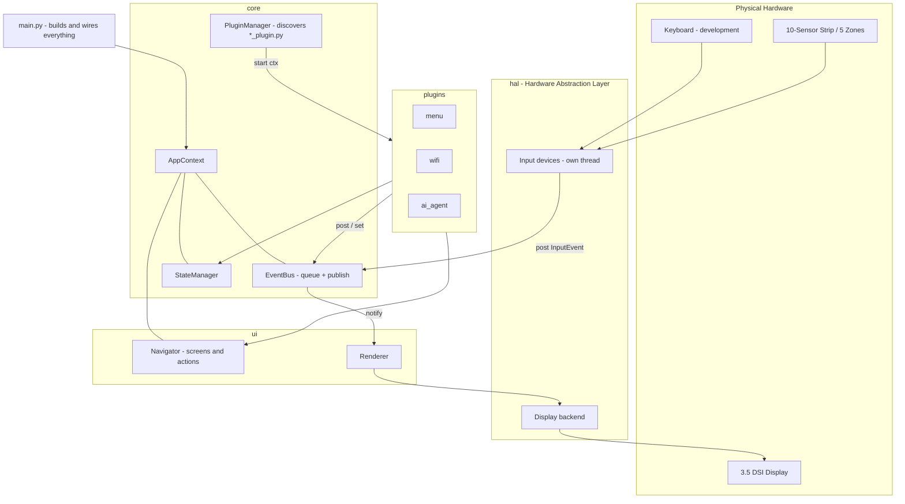
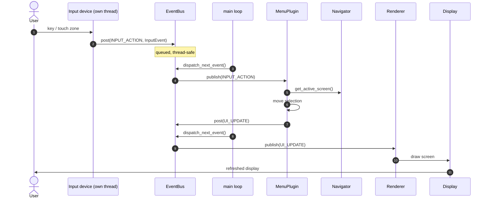

# System Architecture - Standalone Raspberry Pi Project

> Status: core, plugin system, navigator and tests are implemented.
> Input devices, the renderer and the display backend are planned.

## 1. Component Diagram

## 2. Input Sequence

## 3. Rules

- **Threads**: only input devices run in their own thread. They use
  `EventBus.post()` and nothing else. All subscribers run in the main
  thread, one event at a time.
- **post vs publish**: `post` queues an event (any thread). `publish`
  delivers immediately and is called by the main thread only
  (inside `dispatch_next_event`, or by `StateManager`).
- **Dependencies point one way**: `plugins` -> `ui`, `core`;
  `ui` and `hal` -> `core`; `core` imports nothing from the others
  at runtime (type-only imports go under `TYPE_CHECKING`).
- **Plugins** live in `plugins/<name>/<name>_plugin.py`, extend `Plugin`
  and talk to the rest only through `ctx` (events and state), never by
  importing each other.
- **Wiring**: `main.py` is the only place that creates the services and
  passes them down.